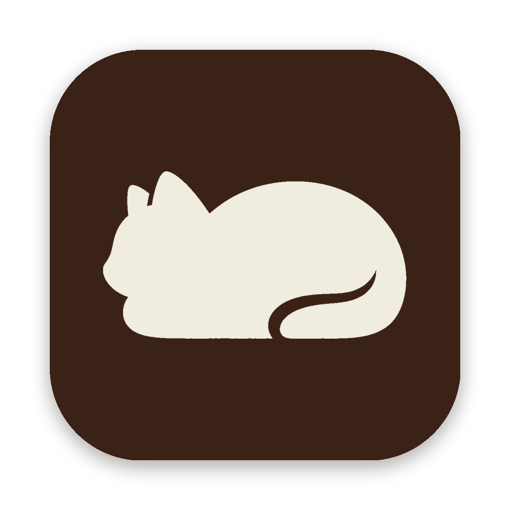
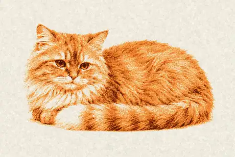
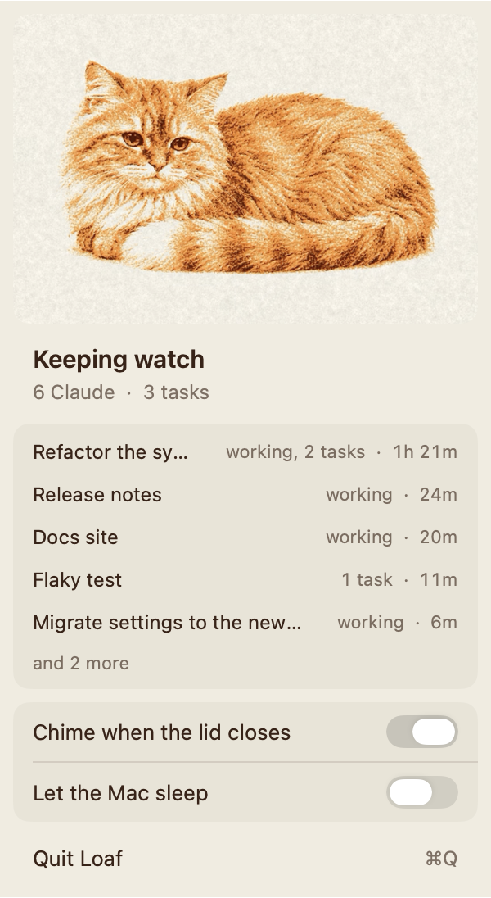
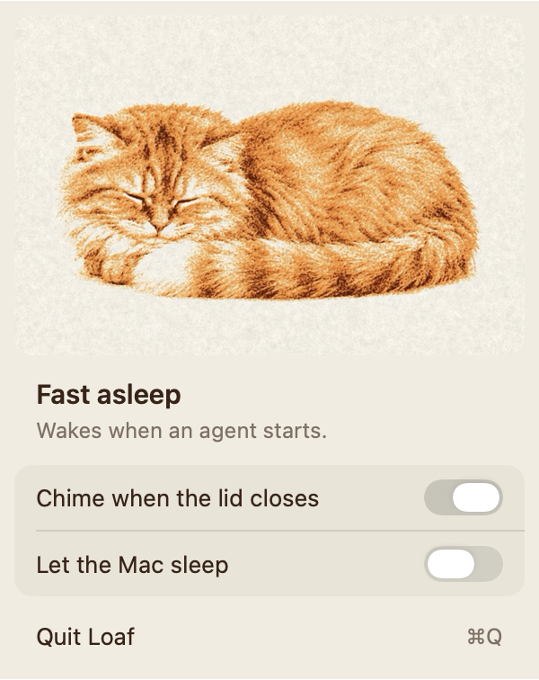

<p align="center">
  
</p>

<h1 align="center">Loaf</h1>

<p align="center">A cat in the menu bar that keeps your Mac awake while coding agents work,<br>and lets it sleep once they're done.</p>

<p align="center">
  
</p>

Close the lid on a long agent run and the Mac stays up until the last session finishes. Then the cat settles down, the hold is released, and the Mac sleeps on its usual schedule. Nothing to remember to turn off.

<table>
  <tr>
    <td width="50%">
      <picture>
        <source media="(prefers-color-scheme: dark)" srcset="docs/panel-awake-dark.png">
        
      </picture>
    </td>
    <td width="50%" valign="top">
      <picture>
        <source media="(prefers-color-scheme: dark)" srcset="docs/panel-asleep-dark.png">
        
      </picture>
    </td>
  </tr>
</table>

## What it does

- **Watches your sessions.** Claude Code sessions report through hooks, Codex sessions through their rollout files, and background tasks through their output. Each working session gets a row with its title and how long it has run.
- **Holds the Mac awake only while something runs.** A short grace period follows the last session, then the hold goes away.
- **Keeps working with the lid shut.** With the optional sleep helper installed, the Mac stays awake closed, and a soft chime plays as the lid comes down so you know it heard you.
- **Steps aside when asked.** "Let the Mac sleep" lets the Mac sleep on schedule until it next wakes, agents or not.

The menu-bar cat is solid while the Mac is held awake and an outline when it is free to sleep.

## Install

Needs macOS 14 or later and the Xcode command line tools (`xcode-select --install`).

```bash
git clone https://github.com/scryst/loaf.git && cd loaf
./install.sh
```

`install.sh` builds `Loaf.app` into `~/Applications`, adds its Claude Code hooks to `~/.claude/settings.json` (backing the file up first and leaving your other hooks alone), and starts Loaf at login with a small watchdog beside it.

To keep the Mac awake with the lid closed, install the sleep helper once:

```bash
sudo ./install-sleep-helper.sh
```

It adds one sudoers rule that lets your user run `pmset -a disablesleep 0` and `pmset -a disablesleep 1` without a password, and nothing else. If Loaf quits or crashes, the watchdog turns sleep back on within a minute.

## Uninstall

```bash
launchctl bootout gui/$UID/app.loaf.Loaf; launchctl bootout gui/$UID/app.loaf.Loaf.watchdog
rm ~/Library/LaunchAgents/app.loaf.Loaf*.plist; rm -rf ~/Applications/Loaf.app
sudo rm -f /etc/sudoers.d/loaf
```

Then delete the entries that mention `loaf-busy-hook` from `~/.claude/settings.json`.

## Development

```bash
./test.sh
```

Builds into a temporary folder and runs the install, hook and headless checks without touching the running copy. `LOAF_RENDER=<dir>` renders every panel state in light and dark to PNG, which is how the images above were made.

## License

[MIT](LICENSE)
