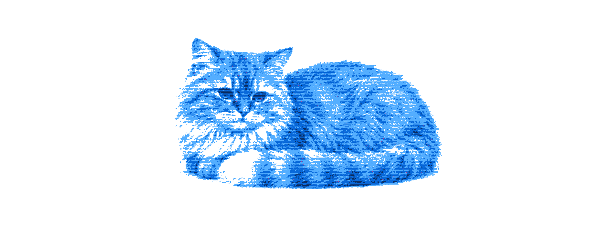
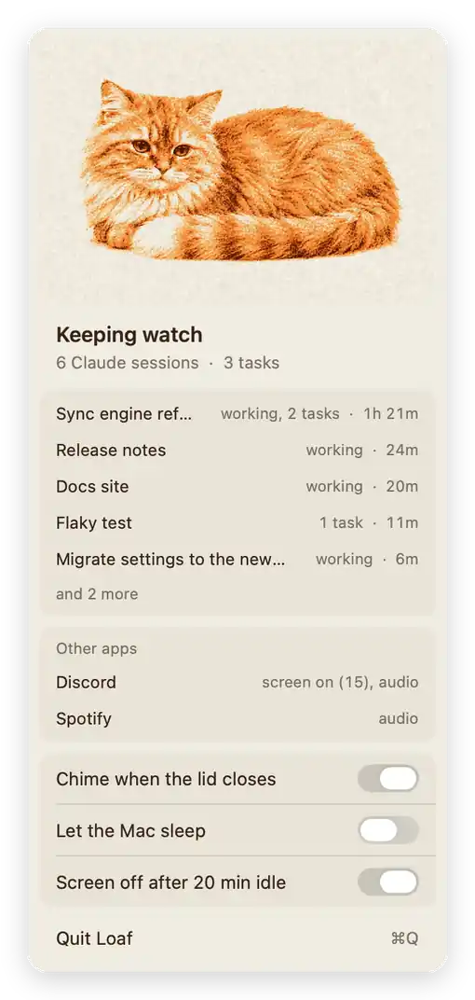

<p align="center">
  <picture>
    <source media="(max-width: 600px) and (prefers-color-scheme: dark)" srcset="docs/banner-phone-dark.webp">
    <source media="(max-width: 600px)" srcset="docs/banner-phone-light.webp">
    <source media="(prefers-color-scheme: dark)" srcset="docs/banner-dark.webp">
    
  </picture>
</p>

<h1 align="center">Loaf</h1>

<p align="center">Keeps your Mac awake while coding agents work, lid open or shut, and lets it sleep when they're done.</p>

<p align="center">Free and open source.</p>

<br>

Close the lid on a long agent run and walk away. The Mac stays up until the last session finishes, the cat in the menu bar settles down two minutes later, and the Mac goes back to sleeping on its usual schedule. There is nothing to turn off afterwards.

<p align="center">
  <picture>
    <source media="(prefers-color-scheme: dark)" srcset="docs/loaf-dark.webp">
    
  </picture>
</p>

Click the cat to see who is keeping it up: each working session by its title, how long it has run, and any background tasks it left going. Claude Code reports through hooks, Codex through the session files it writes as it works, and a background task counts for as long as it keeps writing output. Stopping a turn halfway counts as finishing it, and "Let the Mac sleep" in the card lets the Mac sleep on schedule while agents work, until it next wakes.

## With the lid shut

macOS sleeps a closed MacBook no matter what an app asks, so holding it open needs one small helper that you install with sudo (below). Until it is in, the card says that closing the lid will still sleep the Mac. With it, the lid comes down without the Mac sleeping, and a soft chime plays as it closes so you know Loaf heard it. Loaf lets go at 10% battery or when the Mac runs hot, and puts a shut Mac to sleep right away when it does. If Loaf quits or crashes, a watchdog turns sleep back on within a minute.

## When something else is keeping it up

Below your sessions the card lists anything else holding the Mac or the screen awake, read live: a long build you wrapped in `caffeinate`, a player with its audio still open. Some apps take a screen lock and never let it go. After 20 minutes without input, when only a lock like that is holding the screen, Loaf turns the screen off. A browser really playing a video still keeps it on. The switch is in the card.

## On battery

The card shows the charge, and a notification comes at 20% and again at 10%. Loaf asks to send them the first time you open the card. If they are turned off, the card says so while the Mac is on battery, with a link to the setting. At 10% Loaf stops counting your agents as a reason to stay up, so an idle Mac can sleep before it runs flat, and it starts again once the charge is back above 14% or the Mac is plugged in. To hear about it on your phone as well, point `alertCommand` at any program that takes a title and a message:

```bash
defaults write app.loaf.Loaf alertCommand -array /path/to/your/notifier
```

## Install

Needs macOS 14 or later and the Xcode command line tools (`xcode-select --install`).

```bash
git clone https://github.com/scryst/loaf.git && cd loaf
./install.sh
```

This builds `Loaf.app` into `~/Applications`, adds Loaf's hooks to `~/.claude/settings.json` (it backs the file up first and leaves your other hooks alone), and starts Loaf at login with its watchdog. Quit Loaf from the card and it stays off until you next log in or open `~/Applications/Loaf.app`.

To keep the Mac awake with the lid shut, add the helper once:

```bash
sudo ./install-sleep-helper.sh
```

It is a single sudoers rule that lets your user run `pmset -a disablesleep 0` and `pmset -a disablesleep 1` without a password, and nothing else.

## Uninstall

From the folder you installed from, take Loaf's hooks out of `~/.claude/settings.json` first (your other hooks stay), then remove the rest:

```bash
python3 install-hooks.py --remove
launchctl bootout gui/$UID/app.loaf.Loaf; launchctl bootout gui/$UID/app.loaf.Loaf.watchdog
rm ~/Library/LaunchAgents/app.loaf.Loaf*.plist
rm -rf ~/Applications/Loaf.app ~/Library/Application\ Support/Loaf ~/Library/Logs/Loaf
defaults delete app.loaf.Loaf
sudo rm -f /etc/sudoers.d/loaf
```

If you had a `~/.claude/settings.json` before, the install kept a copy of it as `settings.json.bak-loaf-<date>` beside it; delete that whenever you like.

## Development

```bash
./test.sh
```

Builds into a temporary folder and runs the install, hook and headless checks without touching the copy you are running. `LOAF_RENDER=<dir>` draws every state of the card in light and dark, `art/readme_loop.py` turns those renders and the cat's clips into the card loop on this page, and `art/banner.py` prints the clips for the banner at the top.

## License

Free to use, change and share under the [MIT license](LICENSE).
